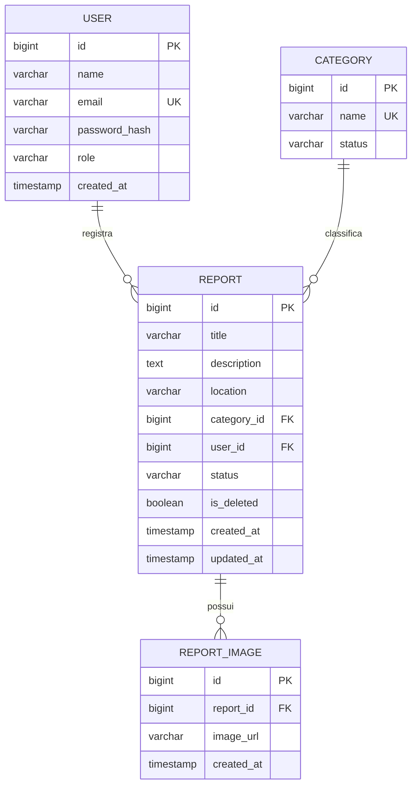

# Modelo de Domínio — Eco-Report

## 1. Descrição

O modelo de domínio do Eco-Report representa os usuários, as categorias de ocorrências ambientais, as ocorrências registradas e os metadados das imagens associadas a essas ocorrências.

## 2. Entidades

### User (Usuário)

Representa uma pessoa cadastrada no sistema.

Principais atributos:

- `id`: identificador único.
- `name`: nome do usuário.
- `email`: endereço de e-mail único.
- `passwordHash`: senha armazenada em formato de hash.
- `role`: papel atribuído ao usuário.
- `createdAt`: data de criação do cadastro.

### Category (Categoria)

Representa a classificação de uma ocorrência ambiental.

Principais atributos:

- `id`: identificador único.
- `name`: nome da categoria.
- `status`: indica se a categoria está ativa ou inativa.

### Report (Ocorrência)

Representa uma ocorrência ambiental registrada no sistema.

Principais atributos:

- `id`: identificador único.
- `title`: título da ocorrência.
- `description`: descrição da situação.
- `location`: endereço ou descrição do local.
- `categoryId`: referência à categoria associada.
- `userId`: referência ao usuário que registrou a ocorrência.
- `status`: situação atual da ocorrência.
- `isDeleted`: indica se a ocorrência foi excluída logicamente.
- `createdAt`: data de criação.
- `updatedAt`: data da última atualização.

Os status permitidos são `PENDING`, `IN_ANALYSIS` e `RESOLVED`.

### ReportImage (Imagem da Ocorrência)

Representa os metadados de uma imagem associada a uma ocorrência.

Principais atributos:

- `id`: identificador único.
- `reportId`: referência à ocorrência.
- `imageUrl`: referência da imagem.
- `createdAt`: data de criação do registro.

O módulo de imagens está previsto no modelo de dados, mas seu fluxo funcional será desenvolvido posteriormente.

## 3. Relacionamentos

- **User 1:N Report:** um usuário pode registrar várias ocorrências, mas cada ocorrência pertence a um único usuário.
- **Category 1:N Report:** uma categoria pode classificar várias ocorrências, mas cada ocorrência está associada a uma única categoria.
- **Report 1:N ReportImage:** uma ocorrência pode possuir vários registros de imagens, e cada registro de imagem pertence a uma única ocorrência.

## 4. Diagrama do modelo de domínio

## 5. Integridade dos dados

- Cada ocorrência deve referenciar um usuário existente e uma categoria existente.
- Os e-mails dos usuários são únicos.
- Os nomes das categorias são únicos.
- O status de uma ocorrência deve respeitar os valores permitidos.
- A exclusão de uma ocorrência é lógica, preservando o registro no banco de dados.
